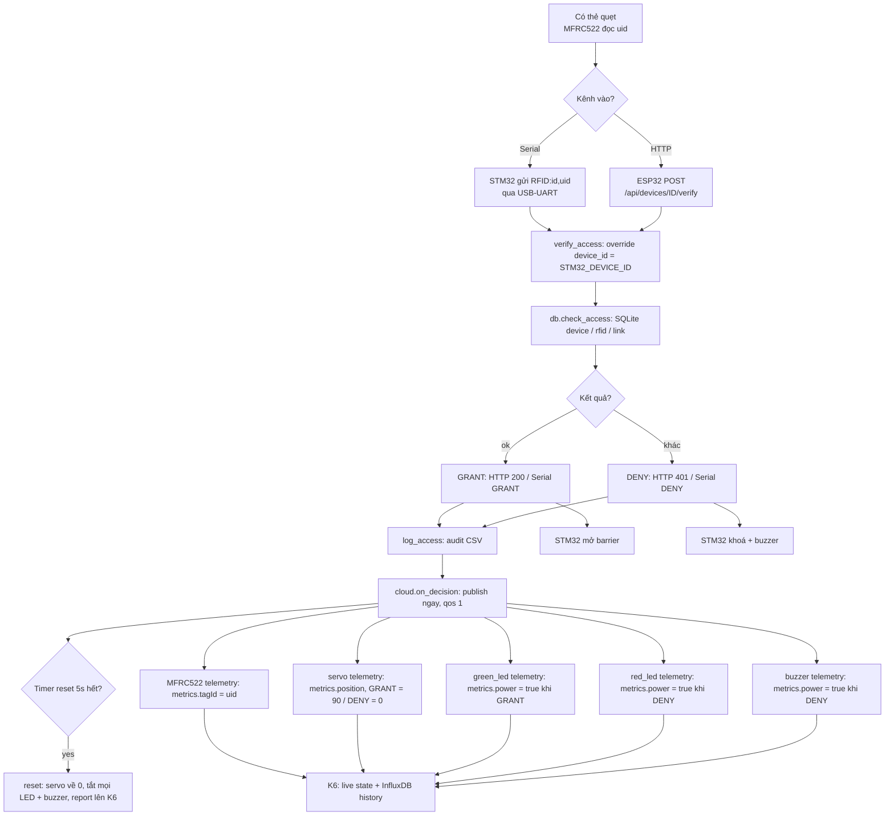
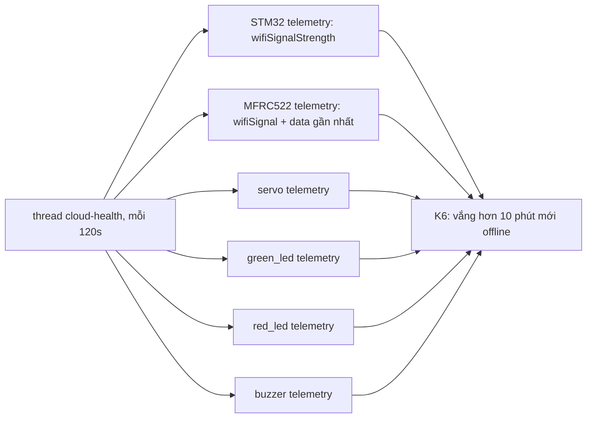

// ...existing code...

# Access Control - Edge + ESP32 Gateway

Chỉ gồm 2 phần theo scope hiện tại: edge (Python) và firmware ESP32.
Phần STM32 (đọc RFID, điều khiển barrier/LED/buzzer) không nằm trong repo này —
nó chỉ giao tiếp UART với ESP32 theo giao thức dưới đây.

## Kiến trúc

```
STM32  <--UART-->  ESP32  <--WiFi / LAN nội bộ-->  Edge (Python + SQLite)
   |                                                    ^
   +---------- USB-UART CP2102 (UART trực tiếp) -------+
```

Edge nhận cả 2 đường vào: qua ESP32 gateway (HTTP) hoặc qua USB-UART (serial),
dùng chung logic verify và chung audit log.

## Quan trọng: `device_id` là của STM32

`device_id` ở đây là ID của STM32, không phải MAC của ESP32.

- STM32 là nguồn phát sinh request truy cập
- ESP32 chỉ đóng vai trò gateway, chuyển tiếp request qua WiFi
- Không thay `device_id` bằng MAC của ESP32

Vì vậy, route chính của edge là:

```
POST http://<EDGE_IP>:5000/api/devices/<device_id>/verify
```

Body JSON:

```json
{
  "rfid_uid": "0A1B2C3D"
}
```

Response:

```json
{ "result": "granted", "reason": "ok" }
```

hoặc

```json
{ "result": "denied", "reason": "rfid_not_linked_to_device" }
```

## Giao thức

### STM32 <-> ESP32 (UART, 115200 8N1)

| Hướng          | Nội dung       | Ý nghĩa                  |
| -------------- | -------------- | ------------------------ |
| STM32 -> ESP32 | `RFID:<uid>\n` | Có thẻ quẹt, gửi UID lên |
| ESP32 -> STM32 | `GRANT\n`      | Cho phép mở barrier      |
| ESP32 -> STM32 | `DENY\n`       | Từ chối                  |

### ESP32 <-> Edge (HTTP JSON)

Endpoint hiện tại:

```http
POST http://<EDGE_IP>:5000/api/devices/<device_id>/verify
Content-Type: application/json
```

Body:

```json
{
  "rfid_uid": "04A1B2C3"
}
```

Edge sẽ kiểm tra:

- `device_id` có tồn tại trong DB không
- `rfid_uid` có tồn tại trong DB không
- `device_id` và `rfid_uid` có liên kết với nhau không

Nếu cần tương thích ngược, repo vẫn giữ endpoint cũ:

```http
POST http://<EDGE_IP>:5000/api/verify
Content-Type: application/json
```

Body:

```json
{
  "device_id": "AABBCCDDEEFF",
  "rfid_uid": "04A1B2C3"
}
```

## Chạy Edge

Từ thư mục project:

```bash
cd d:\embedded-software\access-control-2-edeg
python -m pip install -r requirements.txt

python server.py                  # chỉ HTTP API (như cũ)
python server.py --serial-port auto --device-id AABBCCDDEEFF   # thêm kênh COM
```

Server sẽ chạy tại:

```text
0.0.0.0:5000
```

DB SQLite sẽ được tạo tự động trong thư mục project hiện tại:

```text
access_control.db
```

### Tham số dòng lệnh

| Tham số              | Biến môi trường    | Mặc định  | Ý nghĩa                                       |
| -------------------- | ------------------ | --------- | --------------------------------------------- |
| `--http-host`        | `EDGE_HOST`        | `0.0.0.0` | địa chỉ bind HTTP                             |
| `--http-port`        | `EDGE_PORT`        | `5000`    | port HTTP                                     |
| `--serial-port`      | `EDGE_SERIAL_PORT` | (tắt)     | `COM8`, `/dev/ttyUSB0`, hoặc `auto` để tự dò  |
| `--baud`             | `EDGE_SERIAL_BAUD` | `115200`  | baudrate serial, **phải khớp firmware STM32** |
| `--device-id`        | `EDGE_DEVICE_ID`   | (trống)   | `device_id` mặc định cho kênh serial (STM32)  |
| `--list-ports`       |                    |           | liệt kê cổng COM đang có rồi thoát           |

### Kênh Serial (STM32 nối trực tiếp qua USB-UART CP2102)

Edge hỗ trợ **cả hai kênh cùng lúc**: HTTP cho ESP32 gateway, và serial cho
STM32 nối thẳng qua USB-UART (CP2102/CH340... không cần ESP32). Cả hai dùng chung logic
`db.check_access()` và ghi chung audit log, nên thay gateway không phải sửa
gì trong DB.

Đấu dây CP2102 (logic 3.3V, nhớ nối GND chung):

| CP2102 | STM32F103 |
| ------ | --------- |
| RXD    | PA9 (TX)  |
| TXD    | PA10 (RX) |
| GND    | GND       |

Giao thức trên dây (9600 hoặc 115200 8N1 tùy firmware, kết thúc bằng `\n`) — **giống hệt format mà gateway ESP8266 nhận từ STM32**, nên cùng một firmware STM32 chạy được với cả 2 đường:

| Hướng          | Nội dung                 | Ý nghĩa                                            |
| -------------- | ------------------------ | -------------------------------------------------- |
| STM32 -> edge  | `RFID:<device_id>,<uid>` | quẹt thẻ, đúng format gateway dùng (phẩy, không phải `:`) |
| STM32 -> edge  | `RFID:<uid>`             | quẹt thẻ, dùng `--device-id` của server            |
| STM32 -> edge  | `ID:<device_id>`         | đặt `device_id` mặc định cho session (edge -> `OK`) |
| STM32 -> edge  | `PING`                   | kiểm tra kết nối (edge -> `PONG`)                  |
| STM32 -> edge  | `HELLO`                  | edge -> `DEVICE:<device_id>`                       |
| edge -> STM32  | `GRANT` / `DENY`         | cho phép / từ chối (reason chi tiết chỉ ghi ở log) |

Dấu **phẩy** giữa `device_id` và `uid` là bắt buộc, không phải dấu `:` — vì
`device_id` là MAC, bản thân nó đã chứa `:` (`AA:BB:CC:DD:EE:01`), tách bằng
`:` sẽ nhập nhằng. `device_id` để trống (`RFID:,A1D3E40A9C`) sẽ dùng giá trị
mặc định của server.

Ví dụ một phiên:

```text
STM32 -> RFID:AABBCCDDEEFF,A1D3E40A9C        edge -> GRANT
STM32 -> RFID:AA:BB:CC:DD:EE:01,A1D3E40A9C   edge -> DENY (MAC này chưa có trong DB)
STM32 -> RFID:DEADBEEF00                     edge -> DENY (thiếu device_id)
```

Lưu ý:

- **Baud phải khớp firmware**: code trong `access-control-2/Core` đặt `USART1 = 9600` → chạy `--baud 9600`. Server mặc định 115200 (khớp gateway ESP32), nên nếu firmware STM32 là 9600 thì **phải truyền `--baud 9600`**.
- Dòng rác (không phải lệnh trên) bị bỏ qua, edge không trả lời.
- Lệnh verify thiếu uid (`RFID:`) bị trả `DENY` để phía STM32 không bị treo chờ.
- Rút cáp rồi cắm lại: worker serial tự mở lại cổng sau ~3s.
- `uid` so khớp đúng như lưu trong DB (không tự đổi hoa/thường).

### Không nhận được dữ liệu serial (edge không in `[SERIAL] <- ...`)

1. **Kiểm tra đúng cổng USB-UART chưa** — đây là lỗi hay gặp nhất:

   ```bash
   python server.py --list-ports
   ```

   Cổng USB-UART (CP2102/CH340...) được đánh dấu
   `<-- USB-UART (dùng cổng này)`. Các cổng khác (Arduino, Bluetooth,
   com0com) **mở được nhưng không nối tới STM32**.
   Dùng `--serial-port auto` để tự chọn, hoặc chỉ định đúng `COMx`.
   Khi mở cổng, log in ra cả tên thiết bị:

   ```text
   [SERIAL] mở COM8 @ 115200 8N1 | Silicon Labs CP210x USB to UART Bridge | device_id mặc định: AABBCCDDEEFF
   ```

   Nếu thấy dòng `CẢNH BÁO: ... KHÔNG phải USB-UART` thì đang mở nhầm cổng.

2. **Kiểm tra baud** khớp firmware (xem mục Lưu ý phía trên).

3. **Kiểm tra dây**: chéo TX/RX (CP2102 RXD <- PA9, CP2102 TXD -> PA10),
   nối GND chung, CP2102 để mức 3.3V nếu có jumper.

4. **STM32 chỉ gửi khi đọc được thẻ** (`MFRC522_Check` trong main loop).
   Không quẹt thẻ / đầu đọc chưa ăn thẻ thì edge không nhận gì cả.
   Thử quẹt thẻ đúng loại (13.56MHz Mifare) và xem LED/buzzer trên STM32.

5. **Kiểm tra cổng bị chiếm**: nếu `serial.SerialException` khi mở thì
   đóng Arduino IDE Serial Monitor / phần mềm khác đang giữ cổng.

### Seed dữ liệu mẫu

Nếu muốn nạp dữ liệu test mẫu:

```bash
python -c "import db; db.seed_sample_data()"
```

Dữ liệu mẫu ví dụ trong `db.py`:

- device: `AABBCCDDEEFF`
- rfid: `04A1B2C3`, `0A1B2C3D`
- liên kết: `AABBCCDDEEFF` -> `04A1B2C3`, `0A1B2C3D`

## Các hàm quản lý DB

Trong `db.py` có các hàm chính:

- `add_device(device_id)`
- `add_rfid(rfid_id)`
- `link_rfid_to_device(device_id, rfid_id)`
- `set_device_disabled(device_id, disabled)`
- `set_rfid_disabled(rfid_id, disabled)`
- `check_access(device_id, rfid_id) -> (bool, reason)`
- `log_access(device_id, rfid_id, result, reason)`

## Nạp firmware ESP32

1. Mở file firmware ESP32 trong thư mục `esp32/`
2. Sửa các hằng số:
   - `WIFI_SSID`
   - `WIFI_PASS`
   - `EDGE_HOST`
   - `EDGE_PORT`
3. Đấu dây UART:
   - `UART_RX_PIN=16` nối TX của STM32
   - `UART_TX_PIN=17` nối RX của STM32
   - nối GND chung
4. Nạp code, mở Serial Monitor, kiểm tra log
5. Lấy IP của edge và kiểm tra endpoint

## Ví dụ request test

```bash
curl.exe -X POST http://192.168.2.185:5000/api/devices/AABBCCDDEEFF/verify ^
  -H "Content-Type: application/json" ^
  --data "{\"rfid_uid\":\"04A1B2C3\"}"
```

Kết quả mong đợi nếu UID được liên kết với device:

```json
{
  "result": "granted",
  "reason": "ok"
}
```

## Tích hợp K6 cloud (README.cloud.md)

Edge có thể đẩy dữ liệu lên platform **NEXUS K6** (`README.cloud.md`) qua
MQTT. Edge đứng vai trò **gateway**: đăng ký STM32 + các device thành phần
lên K6 (REST) rồi publish telemetry lên broker của K6.

```text
STM32/MFRC522/servo/LEDs/buzzer ── UART/HTTP ──► Edge (server.py)
                                                  ├─ REST  : đăng ký device + token (POST /api/devices, provision:true)
                                                  └─ MQTT  : k6/{projectId}/{deviceId}/telemetry + /status
```

### Flow 1 — Register devices (lần đầu serial link UP)

```mermaid
flowchart TD
    A[Serial mở cổng COM thành công] --> B["set_link(True, device_id)"]
    B --> C{Fleet đã đăng ký<br/>trên K6 chưa?}
    C -- đã có trong registry --> S[set_link: status = online cho cả fleet]
    C -- chưa --> D[REST: login operator<br/>POST /api/auth/login<br/>→ bearer token]
    D --> E[REST: POST /api/devices<br/>provision: true, idempotent]

    subgraph FLEET [6 device cho mỗi STM32]
        direction TB
        E1[STM32 421108000003<br/>Industrial Controller<br/>5122000001]
        E2[MFRC522<br/>Card Reader 4211000008 (actuator)<br/>parent = STM32]
        E3[Servo<br/>Servo Motor 4211000006<br/>parent = STM32]
        E4[Green LED<br/>Smart LED 4211000001<br/>parent = STM32]
        E5[Red LED<br/>Smart LED 4211000001<br/>parent = STM32]
        E6[Buzzer<br/>Smart Switch 4211000002<br/>parent = STM32]
    end

    E --> E1 --> E2 --> E3 --> E4 --> E5 --> E6

    E1 & E2 & E3 & E4 & E5 & E6 --> F{HTTP response?}
    F -- 201 --> G[save token vào cloud_credentials.json]
    F -- 409 --> H[dùng token cache hoặc rotate token]
    G --> I[MQTT connect tới K6 broker]
    H --> I
    I --> J[MQTT publish status = online, retained cho 6 topics]
    J --> S
```

### Flow 2 — Send data sau decision (GRANT / DENY)



### Flow 3 — Health heartbeat (mỗi 2 phút)



 Fleet được đăng ký trên K6 cho mỗi STM32 (device id 12-hex theo quy ước
 K6): STM32 là `Industrial Controller` (`5122000001`), các thành phần là
 device con (parent = STM32):

| Thành phần | K6 device type | Data capabilities |
| ---------- | -------------- | ----------------- |
| MFRC522    | `4211000008` Card Reader (actuator) | `tagId` |
| Servo      | `4211000006` Servo Motor | `position` (0 = Đóng, 90 = Mở) |
| Green LED  | `4211000001` Smart LED   | `power` |
| Red LED    | `4211000001` Smart LED   | `power` |
| Buzzer     | `4211000002` Smart Switch| `power` |

### Trạng thái actuators theo decision (auto-reset 5s)

| Decision | Servo | Green LED | Red LED | Buzzer |
| -------- | ----- | --------- | ------- | ------ |
| **accepted** (GRANT) | `position: 90` (mở) | `power: true` | `power: false` | `power: false` |
| **denied** (DENY)    | `position: 0` (đóng) | `power: false` | `power: true` | `power: true` |
| **reset sau 5s**     | `position: 0` | `power: false` | `power: false` | `power: false` |

- Edge publish trạng thái decision lên K6 **ngay lập tức**, rồi **tự reset sau 5 giây** (`K6_ACTUATOR_RESET_SEC`, thread `threading.Timer`).
- Quẹt thẻ liên tiếp trong khoảng reset: timer cũ bị hủy, timer mới bắt đầu — đúng hành vi thật của barrier.
- `mfrc522.tagId` là event (không bị reset), luôn giữ uid quẹt cuối cùng.

### Dữ liệu gửi lên

- **Mỗi 2 phút** (health heartbeat): frame telemetry cho *mọi* device đã đăng
  ký, gồm connection/network status (`wifiSignalStrength`) + trạng thái gần
  nhất của component.
- **Ngay sau mỗi decision** (HTTP hoặc serial):
  - MFRC522: `metrics.tagId = <uid quẹt>`
  - Servo: `metrics.position = 100` (mở barrier khi GRANT) / `0` (DENY)
  - Green LED: `metrics.power = true` khi GRANT
  - Red LED: `metrics.power = true` khi DENY
  - Buzzer: `metrics.power = true` khi DENY
- **Serial link up/down**: publish retained status `online`/`offline` cho cả
  fleet (K6 sẽ đánh dấu device offline qua last-will/timeout).

Device đã provisioned rồi thì dùng lại token cache trong
`cloud_credentials.json` — provisioning là idempotent, chạy lại không mất token.

> **Hardcode device_id STM32 (tạm thời)**: firmware STM32 hiện đang gửi
> device_id khác chưa sửa được, nên `server.py` ghi đè mọi device_id từ MCU
> bằng hằng `STM32_DEVICE_ID = "421108000003"` (khớp `seed.py`) ngay trong
> `verify_access()` — áp dụng cho cả kênh HTTP và serial. Khi firmware đã sửa
> đúng, xoá dòng override này.

### Bật cloud

```bash
pip install -r requirements.txt            # thêm requests + paho-mqtt
export K6_MQTT_URL=mqtt://127.0.0.1:1883
export K6_API_URL=http://127.0.0.1:8080
export K6_PROJECT_ID=<uuid project>        # lấy từ console K6
python server.py --serial-port auto        # cloud tự bật khi có đủ biến
```

| Biến môi trường        | Mặc định                | Ý nghĩa                                  |
| ---------------------- | ----------------------- | ---------------------------------------- |
| `K6_ENABLED`           | `1`                     | `0` để tắt đẩy dữ liệu lên cloud          |
| `K6_MQTT_URL`          | `mqtt://127.0.0.1:1883` | broker MQTT của K6                        |
| `K6_API_URL`           | `http://127.0.0.1:8080` | REST API của K6 backend (provisioning)    |
| `K6_PROJECT_ID`        | (bắt buộc khi bật)      | uuid project trên K6                      |
| `K6_AUTH_EMAIL`        | `operator@nexus.local`  | operator dùng để provision device         |
| `K6_AUTH_PASSWORD`     | `nexus`                 | mật khẩu operator                         |
| `K6_HEALTH_INTERVAL_SEC`| `120`                  | chu kỳ health heartbeat (giây)            |
| `K6_NETWORK_DBM`       | `-60`                   | giá trị network signal báo lên            |
| `K6_CREDENTIALS_FILE`  | `cloud_credentials.json`| cache device token                        |

Hoặc chạy kèm flag `--no-cloud` để tắt cloud cho phiên chạy hiện tại.

## Ghi chú bảo mật

- Hiện tại edge không có xác thực request (dùng trong LAN nội bộ)
- Nếu triển khai thực tế, nên thêm API key/token giữa ESP32 và edge
- Khi ESP32 không gọi được edge hoặc timeout, nên mặc định trả `DENY` để fail-closed
